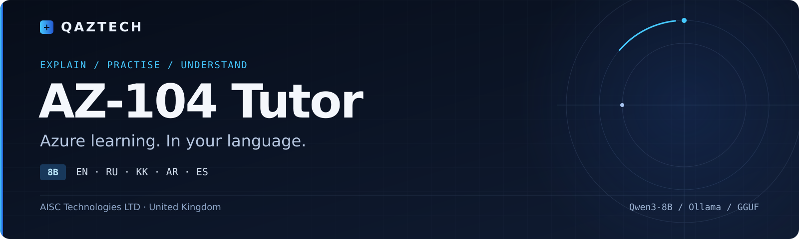

[English](README.md) · **Русский обзор**

# QAZTECH® AZ-104 Tutor 8B

**Мультиязычный тьютор по Azure с локальным запуском.**

Модель объясняет концепции Azure, разбирает заблуждения и составляет тренировочные вопросы в стиле AZ-104 с объяснением ответа. Целевые языки: английский, русский, казахский, арабский и испанский. Качество зависит от языка и темы.

Это русский обзор проекта. Полное описание конвейера и исходные инструкции: [English README](README.md).

## Выбор модели

| Задача | Модель |
| --- | --- |
| Изучать Azure и готовиться к AZ-104 | [AZ-104 Tutor 8B](https://github.com/qaztech-platform/qaztech-az104) |
| Писать, проверять и разбирать инфраструктурный код Azure | [Azure Engineer 8B](https://github.com/qaztech-platform/qaztech-azure) |

## Быстрый запуск

При установленном Ollama:

```bash
ollama run qaztech-platform/az104-tutor
```

Пример запроса: «Дай тренировочный вопрос по Azure RBAC и объясни, почему остальные варианты ответа неверны».

Для Transformers используйте `enable_thinking=False`: модель обучена без трасс рассуждения. Пример кода есть в [английском README](README.md#quick-start).

## Модели и форматы

| Платформа | Формат | Ссылка |
| --- | --- | --- |
| Hugging Face | bf16 safetensors, 16,4 ГБ | [QAZTECH-AZ104-Tutor-8B](https://huggingface.co/qaztech-platform/QAZTECH-AZ104-Tutor-8B) |
| Hugging Face | GGUF Q4_K_M, 5,0 ГБ; Q8_0, 8,7 ГБ | [QAZTECH-AZ104-Tutor-8B-GGUF](https://huggingface.co/qaztech-platform/QAZTECH-AZ104-Tutor-8B-GGUF) |
| Ollama | Q4_K_M | [qaztech-platform/az104-tutor](https://ollama.com/qaztech-platform/az104-tutor) |
| ModelScope | bf16 safetensors | [QAZTECH-AZ104-Tutor-8B](https://modelscope.cn/models/qaztechplatform/QAZTECH-AZ104-Tutor-8B) |
| Kaggle | Transformers и GGUF | [qaztech-az104-tutor-8b](https://www.kaggle.com/models/qaztechplatform/qaztech-az104-tutor-8b) |

## Опубликованные результаты v0.2

| Показатель | Результат |
| --- | --- |
| Обучающие примеры | 4 907; отдельно 200 отложенных |
| Loss на отложенной выборке | 0,895 → 0,795 |
| Точность предсказания токенов | 0,773 |
| Язык ответа совпал с языком запроса | 5 из 5 проверочных запросов |
| Маркер `<think>` в ответе | 0 из 5 |
| Обучение | 1× A100 40 ГБ, около 55 минут |

Пять языковых примеров — небольшая проверка поведения; она не измеряет фактическую точность на AZ-104. Исходные результаты и замечания: [docs/RESULTS.md](docs/RESULTS.md).

## Документация

| Материал | Содержание |
| --- | --- |
| [Воспроизведение](docs/REPRODUCE.md) | Оборудование, среды, генерация данных, обучение и экспорт |
| [Данные](docs/DATA.md) | Источники, фильтрация и состав выборки |
| [Результаты](docs/RESULTS.md) | Кривая обучения и проверка поведения |
| [Развёртывание](deploy/README.md) | Сборка Ollama и рекомендации по запуску |
| [Публикация](docs/PUBLISHING.md) | Публикация артефактов |
| [Участие](CONTRIBUTING.md) | Проверка языков, исправление фактов и развитие конвейера |

## Ограничения

- В ответах обнаруживались неправильные названия разрешений и описания поведения Azure. Сверяйте технические рекомендации с Microsoft Learn; для рабочих сценариев используйте поиск по официальной документации.
- Казахские и арабские ответы ещё не прошли проверку носителями языка. Казахские формулировки могут быть неестественными.
- Обучающие материалы охватывают RBAC, виртуальные сети, Azure Resource Manager и App Service.
- Модель не содержит настоящих экзаменационных вопросов Microsoft. Проект не аффилирован с Microsoft и не одобрен этой компанией.

## Лицензия и авторство

Код и веса: [Apache-2.0](LICENSE). Базовая модель — Qwen3-8B от Alibaba Cloud. Материалы Azure использованы на условиях CC BY 4.0; см. [NOTICE](NOTICE). Условия использования названия QAZTECH: [TRADEMARK.md](TRADEMARK.md). Сведения для цитирования: [CITATION.cff](CITATION.cff).

**AISC Technologies LTD · United Kingdom.** [Вопросы и обратная связь](https://github.com/qaztech-platform/qaztech-az104/issues).
